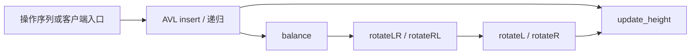

# QCIP / QCP 与网上复杂程序选题审查

日期：2026-11-03。当前阶段仅做源码阅读和任务设计，没有运行 QCP、编译 C、重放 Rocq 证明或验证新的实现对。

## 查看的实际材料

本机仓库是 `/home/yangfp/QCIP`，remote 为 `https://github.com/taylor-swift-13/QCIP`，读取时 HEAD 为 `fb3544dd349fe273b469e79828dd10b6a37fa184`。遵循该仓库示例阅读边界，选择 `QCP_demos_LLM`、`LLM_bench` 和 `OUTPUT`，没有将 human 示例作为证明参考。

[选择清单](qcip-selection.json)列出 28 个 C 文件。[审查记录](qcip-source-audit.json)保存每个文件的 SHA-256、相对路径、是否与 HEAD 相同、去注释代码行数和词法函数／调用信息。24 个文件与 QCIP HEAD 的对应文件一致，4 个是本地修改或未跟踪文件：

- `OUTPUT/xizi/xizi_circular_area_write/source/xizi_circular_area_write.c`：本地修改；
- `OUTPUT/xizi/xizi_avl_insert/source/xizi_avl_insert.c`：未跟踪；
- `OUTPUT/xizi/xizi_avl_delete_crtos/source/xizi_avl_delete_crtos.c`：未跟踪；
- `OUTPUT/xizi/xizi_avl_left_rotate/source/xizi_avl_left_rotate.c`：未跟踪。

因此，QCIP commit 不能单独标识这四个文件；后续导入必须同时绑定记录里的内容 hash。这里的 HEAD 一致性只针对 QCIP 仓库，不能推出程序与 CRTOS 原始上游逐函数一致。

## 最有价值的本地候选

| 实际源文件／组 | 阅读到的程序结构 | 为什么适合 EqualBench | 需要补齐的边界 |
|---|---|---|---|
| `QCP_demos_LLM/functional_queue.c`、`sll_queue.c`、`dll_queue.c` | 两列表队列有 `enqueue → push`、`dequeue → reverse/pop`；另有单链和双链队列 | 已有多种表示和调用分解，可比较操作序列 | 分配／释放及 `reverse` 只有声明时必须补实现；空队列调用须由固定 driver 处理 |
| `QCP_demos_LLM/bst_delete_rec2.c` 与 `bst_delete_new.c` | 前者递归寻找前驱并复制键值，后者以指针到指针寻找后继并移植节点 | 现成的算法、递归和堆结构差异，且最终树形可以不同 | 不比较根地址或整棵树形；用 lookup 返回值轨迹比较映射，限定无外部节点句柄 |
| `QCP_demos_LLM/avl_insert.c` | 8 个有函数体的函数，115 行去注释代码；`insert → balance → rotateLR/rotateRL → rotateL/rotateR → update_height` | 递归调用与多层辅助函数组合，适合较高难度 | 关闭分配器调用；明确重复键是忽略还是覆盖；不能把“少旋转”直接标为不等价 |
| `OUTPUT/xizi/...circular_area_read/write...` | read 有 5 个函数体、106 行去注释代码；write 有 4 个函数体、103 行；跨边界复制和多次状态查询 | 环形 FIFO、批处理与逐字节实现、满空状态和强制覆盖 | `memcpy`、诊断日志和初始化／释放调用必须明确；read/write 副本不能因同名就视作同一环境 |
| `OUTPUT/xizi/...double_link_callpoint_specs...` | 客户端组合初始化、插入、删除、长度／遍历查询 | 适合从单函数上升到客户端操作序列 | 文件中的被调函数主要是声明，需要链接实际实现；正反向遍历都要观察 |
| `OUTPUT/binaryTree/...invert...`、`...height...` | 递归原地镜像、递归高度计算 | 可与显式栈遍历比较，核心不需要动态分配 | 只观察高度不足以发现漏翻转；应比较最终带标签树的投影及高度 |
| `QCP_demos_LLM/union_find_err_rel.c` | `union` 调用两次递归 `find`；`find` 路径压缩 | 内部数组明显不同，但连通性观察应一致 | 返回根编号不是稳定观察；文件名里的 `err` 不能作为程序有错的证据 |
| `LLM_bench/Data_structures/priority_queue/priority_queue.c` | `push/build/pop/heap_sort` 四个函数；`build → push`，`heap_sort → build/pop` | 有批量构建和客户端调用，能比较堆／有序数组／扫描数组 | 这里是最大堆；不要直接和 Dijkstra 的最小优先队列配对 |
| `LLM_bench/Algorithms/Dijkstra/` 两个文件 | 主算法调用 init、clear、empty、push、pop；`Dijkstra_priority_queue.c` 的实现是有序数组，非二叉堆 | 多文件算法与数据结构替换可同时考察 | 必须把两个翻译单元一起冻结；距离上界、INF 和队列容量要覆盖所有有效执行 |
| `QCP_demos_LLM/eval.c` | 带 tag 与 union 的 AST，递归解释器，有短路分支 | 数据结构、递归调用、显式求值栈和辅助函数分解 | 固定算术安全域；无副作用且两边都安全时，急切求值未必产生可观察差异 |

优先落地 `C-DLL`、`C-RING`、`C-TREE`、`C-UF`、`C-PQ` 和 `C-EVAL`；`C-BST`、`C-AVL`、`C-DIJK` 作为后续较难的一组。它们对应的固定程序变体、观察和任务槽位见[复杂任务卡](../complex-task-cards.md)。



该图反映已阅读到的调用结构，不能替代完整 C 调用图或语义证明。

## OUTPUT 的证明记录怎么使用

OUTPUT 的 README 有用，因为它们说明了输入形状、调用依赖、分配器假设和修复历史。但这里没有重放这些记录，也没有把它们当作 EqualBench 的已验证结果。例如：

- `xizi_avl_insert/LEGACY_MODIFIED_README.md` 明确记载执行代码修复，不能称为未修改的 CRTOS 原版；
- `xizi_avl_delete_crtos/README.md` 记载外部分配／日志契约及自动生成文件的信任边界，不能仅凭 manual 文件全为 `Qed` 就宣称整个开发没有假设；
- 环形缓冲区与双链表的 callpoint 文件经常只含 callee 声明，证明一个调用点与交付所有 callee 函数体是不同的产物。

EqualBench 应提取程序及调用关系，隐藏来源中的独立功能后置条件，并为冻结后的程序对重新构造自己的关系证书。求解者仍可自行发明、证明并组合辅助引理或函数级关系。

## 网上找到的补充材料

[VST 的 `bst.c`](https://github.com/PrincetonUniversity/VST/blob/08cb56d32d9ce42505cf8167c4d0bd15fb119d9e/progs/bst.c)提供另一种删除算法，调用链是 `delete → pushdown_left → turn_left`，可补充本机前驱／后继两种删除风格。其节点分配语义需要单独固定。

更有辨识度的是 [VST `VSUpile`](https://github.com/PrincetonUniversity/VST/tree/08cb56d32d9ce42505cf8167c4d0bd15fb119d9e/progs/VSUpile)：普通 pile 每次查询遍历链表求和，fastpile 保存累计和，客户端 `Triang_nth` 跨 API 创建、添加、查询并释放。这直接对应维护中的数据结构替换。[相关原论文](https://doi.org/10.1007/978-3-030-30942-8_34)讨论了这些模块化验证例子。

读源码还能发现很适合设计边界敏感任务的差异：fastpile 的添加函数拒绝负值，而链表版本直接保存负值。因此，两者在限定非负且不溢出的输入域上可作为等价候选；扩大到包含负值的安全输入域后可作为反例候选。这不是 VST 原证明有错的结论，较宽输入域是 EqualBench 新设的任务。

VST 查询固定在 commit `08cb56d32d9ce42505cf8167c4d0bd15fb119d9e`；7 个实际读取的文件及其原始字节 hash 见 [web-source-audit.json](web-source-audit.json)。其中 BST、pile、fastpile 和 triang 四份 C 源码已按原始字节保存到整理用源码库。

## 范围与来源处理

第一版复杂题优先使用调用者预分配的节点、数组和显式工作栈。若将源码的 `malloc/free` 换成有限 arena，必须标成派生程序并记录修改，不得宣称在验证未修改源码。保留原始动态分配语义的 MiniSat `vec.c`、原始队列／pile 和完整 AVL 分配器放入扩展候选。

QCIP 根 LICENSE 是 MIT。XiZi/CRTOS 源码头声明 Mulan PSL v2；VST 的 LICENSE 对 `progs` 测试程序声明 BSD 2-Clause。[源码快照库](../source-material/README.md)保存了 12 份本机 C 文件和 4 份 VST C 文件，复制前逐一匹配审查 hash，并保留各自许可与来源说明。未复制原项目证明文件。源码中的独立功能契约仍是整理材料，不能进入 agent 提示；这些片段还没有补全头文件、调用闭包或生成 Clight AST。

盘点中出现的 `iplib/float`、硬件 I/O、并发和已阅读的 MiniSat 动态向量不进入核心集合；它们需要本版尚未固定的外部行为或分配语义。

## 重复源码盘点

在 EqualBench 仓库根目录、WSL 中运行：

```sh
python3 scripts/curation/audit_qcip_sources.py \
  --root /home/yangfp/QCIP \
  --manifest benchmarks/research/qcip-selection.json \
  --output benchmarks/research/qcip-source-audit.json
```

脚本只读源仓库，不运行证明。函数和调用 token 来自词法扫描，包含宏和未解析外部符号；完整调用闭包仍须在每道任务冻结时审查。

源文件快照可在 PowerShell 中由 `scripts/curation/import_source_snapshots.ps1` 重建。脚本按已记录的 hash 检查源文件是否变化；源仓库变化时会停止导入，而不是悄悄更新任务材料。
